<picture><source media="(max-width: 640px) and (prefers-color-scheme: dark)" srcset=".github/readme/header-phone-dark.svg"><source media="(max-width: 640px)" srcset=".github/readme/header-phone-light.svg"><source media="(prefers-color-scheme: dark)" srcset=".github/readme/header-dark.svg"></picture>

MagLock is a smart lock for two doors that runs entirely on the home network. One ESP32 drives two
magnetic locks through relays, an ESP32-CAM gives a view of the door, and a Flutter app controls both
from a phone or a desktop. There is no vendor cloud in between.

## What it does

| | |
|---|---|
| **Two doors, separately** | Lock or unlock each door on its own, or all of them at once. |
| **Auto-lock timer** | A countdown from 3 to 120 seconds that locks the door again, shown as an arc on the door card. |
| **Live status** | The app asks the controller for its state every two seconds and shows when the connection drops. |
| **Activity log** | Every action, with its time. |
| **Passcode** | An optional 4-digit PIN to open the app. |
| **Cooldown guard** | An 800 ms debounce, so a relay is never cycled rapidly. |

## How it's built

<picture><source media="(max-width: 640px) and (prefers-color-scheme: dark)" srcset=".github/readme/architecture-phone-dark.svg"><source media="(max-width: 640px)" srcset=".github/readme/architecture-phone-light.svg"><source media="(prefers-color-scheme: dark)" srcset=".github/readme/architecture-dark.svg"></picture>

| Part | What it uses |
|---|---|
| App | Flutter and Dart, for Android, iOS, Windows, macOS, Linux and the web |
| Controller | ESP32, Arduino C++, two relay channels |
| Camera | ESP32-CAM |
| Link | Plain HTTP over the local Wi-Fi network |

The controller exposes a small HTTP interface:

| Request | What it does |
|---|---|
| `GET /status` | Reports each door's state and the auto-lock timer |
| `POST /lock?relay=1`, `2` or `all` | Locks one door or both |
| `POST /unlock?relay=1`, `2` or `all` | Unlocks one door or both |

## Status

The lock is built and in use. The firmware and the app are being rebuilt from scratch, and the source
will be published here with the rebuild, along with wiring and build instructions.

Built by [Ali Arbab](https://github.com/thealiarbab), Founder of StockSaathi.
